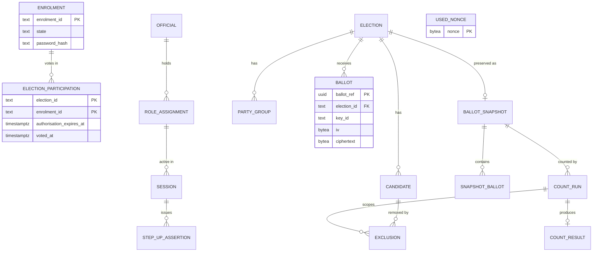

# Database design

Four separate PostgreSQL 16 databases, each in its own container and on its own
Docker network. Section and table numbers refer to the Milestone 2 design.

| Database | Holds | Service logins | Requirements |
|---|---|---|---|
| `roll` | Enrolments, elector credentials, who has voted | `auth_svc` | GR01, GR02 |
| `auth` | Officials, role assignments, sessions, step-up assertions | `auth_svc` | GR03, GR05 |
| `ballot` | Ballots, used nonces, election config, counts, exclusions | `ballot_svc`, `count_svc` | GR01, GR02, GR03 |
| `audit` | Hash-chained audit records | `audit_svc` | GR02, GR05 |

The Recount Service and the Policy Decision Point have **no database login**.
Table 10 only lets Recount call the Count Service, and the PDP decides from the
claims it is given.

## What each login can do

| Login | Can | Cannot |
|---|---|---|
| `auth_svc` on `roll` | Read enrolments, call `issue_authorisation` and `mark_voted`, read participation | Edit the roll, clear a vote, set its own timestamps |
| `auth_svc` on `auth` | Read officials, create sessions and step-ups, consume step-ups | Change role assignments, extend a session, reassign a session's role |
| `ballot_svc` | Call `cast_ballot` and `get_ballot`, read election config | Touch the ballot or nonce tables directly, read counts, list ballots |
| `count_svc` | Manage election config, make the snapshot, run counts, record exclusions | Read the raw ballot or nonce tables |
| `audit_svc` | Insert and read audit records, verify and export chains | Update, delete or truncate records, set a record's hash, sequence or time |

Every write that has a security rule attached goes through a function or a
column-level grant, so a bug in a service cannot skip the rule.

## Schema



`USED_NONCE` has no relationships on purpose. Nothing references it and it
references nothing.

The audit database has one table per record family plus `chain_head`:
`authorisation_record`, `nonce_record`, `operator_record`, `service_record`,
`query_record` and `count_record`. Each has its own columns, and they share
only `seq`, `event_type`, `occurred_minute`, `prev_hash` and `event_hash`.

## How the requirements are enforced

**GR01, single use.** `ballot.cast_ballot` is the only way to write a ballot. It
consumes the nonce and inserts the ballot in one transaction, so `ballot_svc`
cannot store one without the other. A replay returns `NULL`. It also takes a
shared lock on the election, so closing the poll waits for ballots in flight and
no accepted ballot can miss the snapshot.

`roll.issue_authorisation` makes its check and its write in one statement, so
concurrent logins for one enrolment get exactly one authorisation.

**GR02, secrecy.**
- `ballot.ballot` has no elector column, nonce, timestamp or sequence, and its
  key is a random UUID.
- `count_svc` reads only `counting.snapshot_ballot`, a copy made once at the
  close of poll. It has new random IDs and is written in random order, so it
  cannot be joined back to the raw table or ordered by casting time.
- The audit tables have no column that could hold the link. `authorisation_record`
  has `enrolment_id` and no nonce. `nonce_record` has the nonce and no enrolment.
- Every roll and audit timestamp is rounded to the minute and checked by a
  constraint. The database sets these times, not the caller.

**GR03, exclusions.** An exclusion needs a court order reference and a listed
ground, and the election must be in `RECOUNT_OPEN`. Composite foreign keys make
it impossible to name a candidate or count from another election. Exclusions
cannot be changed after they are entered.

**GR04, availability.** The voting path is one function call on random-keyed
tables, with no session lookup. Rate limiting is done in Nginx.

**GR05, audit.** An insert trigger assigns the sequence number, time, previous
hash and event hash, so a caller cannot choose them. Update, delete and truncate
are blocked by triggers, including for the table owner and for superusers unless
they first disable the trigger. `audit.verify_chain(family)` recomputes a chain
inside the database, and `audit.export_chain(family)` returns the exact bytes
that were hashed so an auditor can check them with their own tools:

```
event_hash = sha256(prev_hash || utf8(canonical))
```

## Where this differs from the Milestone 2 document

These need to go back into the report, or be argued against.

1. **`AUTHORISATION_CONSUMED` moved to `nonce_record`.** Table 13 puts it in
   `AuthorisationRecord` with an `enrolmentId`, but the Ballot Service that
   consumes the nonce never knows the enrolment, and writing it would create the
   link GR02 forbids.
2. **One hash chain per family, not one chain overall.** A single chain would
   record the exact order of authorisations relative to accepted ballots, which
   minute-level timestamps were meant to hide.
3. **A sixth family, `count_record`.** Table 13 lists authentication events only,
   and GR05 also needs count and recount events with the fields from Milestone 1.
4. **Nonces and ballots share a database.** They have to, for the atomic
   transaction in Section 2.2. They stay in separate, unrelated tables.
5. **Election and count data live in the `ballot` database**, under separate
   schemas and grants, to keep to the planned four databases.

## Known limits

- **`xmin` and `ctid` undercut "no insertion-ordered key" (Section 4.2).** Postgres
  keeps hidden columns on every row. `ballot.ballot.xmin` gives casting order, and
  a ballot and its nonce have the *same* `xmin` because they share a transaction.
  No service login can read those tables, and ballots are encrypted, so this needs
  database-level access. A database administrator, a stolen disk or the write-ahead
  log could still recover order. Nonces are not linked to electors, so this alone
  does not identify a voter. A real deployment would need encrypted, access-audited
  storage and a retention plan for WAL.
- **Superusers can still tamper.** One who disables the triggers and rewrites a
  whole chain plus `chain_head` would pass `verify_chain`. Detecting that needs
  the head hash published or replicated somewhere outside the database.
- **Each chain handles one append at a time**, because appends lock `chain_head`.
  This is fine for a prototype and should be load tested for peak polling.
- **`election_id`, `count_id` and `operator_id` cross databases without foreign
  keys.** Separate databases cannot enforce them, so services must validate them.
  The separation is the point.

## Decisions still open

- **When `mark_voted` is called.** The schema supports either answer. Calling it
  straight after `issue_authorisation` is the only option that needs no link
  between elector and ballot, but an elector whose token expires unused cannot
  vote online again. Calling it later would need the Ballot Service to report
  back about a specific elector, which GR02 forbids.
- **Which service owns election setup.** No service in Section 1.2 is assigned
  `COMMIT_NOMINATIONS` or `FIX_PARTY_ORDER`. For now `count_svc` holds those
  grants, and moving them is a small change in `ballot/init.sql`.
- **The exclusion grounds** seeded in `counting.exclusion_ground` are placeholders
  and need checking against the legal grounds the group wants to support.

## Running it

Docker Compose for the whole system belongs to the main `docker-compose.yaml`.
This file starts only the databases, for development and tests:

```bash
cp .env.example .env     # then replace every change-me value
docker compose -f db/compose.dev.yaml --env-file .env up -d
python -m pytest tests/db -v
```

`init.sql` only runs on a container's first start. To apply a schema change, and
to clear data left by the tests, reset with:

```bash
docker compose -f db/compose.dev.yaml --env-file .env down -v
```

The tests add rows that cannot be deleted, by design, so only point them at
development databases. If a database cannot be reached the tests **skip**, so
check the summary line says they ran.
